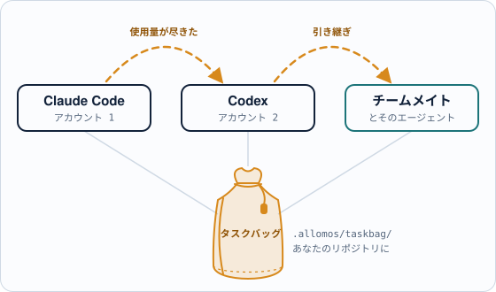
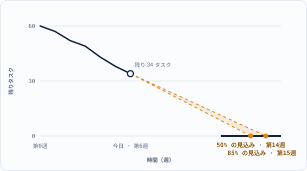

[English](README.md) · [简体中文](README.zh-CN.md) · **日本語**


# アロモス（Allomos）

**エージェントを替えても、チームメイトに渡しても、プロジェクトは途切れない。**

ある AI エージェントやアカウントの使用量が尽きたら、別のエージェントが止まったところから続けます。仕事をチームメイトに渡しても、チャットの中に置き去りになるものはありません。プロジェクトは**タスクバッグ**に入って移動します。あなた自身のリポジトリにある、ただのファイルです。

<picture>
  <source media="(prefers-color-scheme: dark)" srcset="docs/images/readme/hop-ja-dark.svg">
  
</picture>

`ローカルアプリ・無料` · `macOS · Windows` · `Claude Code · Codex` · `クラウド・任意、有料`

> **現状：開発の初期段階です。** v0.1（macOS のローカルなタスク管理）は完成し、v0.2（macOS と Windows、アプリでの編集）を進めています。以下で *（予定）* とある機能はまだできていません。

## 課題：手が替わるたびに、流れが途切れる

バイブコーディングはたくさんのセッションで進みます。Claude Code、Codex、いくつものアカウント、何人もの人。使用量の上限で予告なくセッションが終わり、次のセッションはゼロから始まります。プロジェクトの状況は、手で書いた Markdown と人の頭の中にあります。実際のマルチエージェントの移行プロジェクト（2026 年 9 月）では：

- 新しいセッションが再開のたびに読み直す **185 KB** の引き継ぎメモ
- 一枚のカードの状況を手で写していた場所が **6** か所
- 同時にカードを取り合う **3** つのセッション、決着はマージの衝突
- 「いつ終わるのか」に答えられた人は **0** 人

## アロモスがすること：一つの本題と、それを支える二つ

| | 何のためか | |
|---|---|---|
| **切り替え**（本題） | AI エージェントとチームメイトの間でプロジェクトを渡し、何も失わない。 | リポジトリにタスクバッグ · どのエージェントにも同じコマンド · 引き継ぎも再開も一歩で · チームメイトにプロジェクトを渡す |
| **AI スキル**（第 2 セット） | AI エージェントともっと上手に働く。 | エージェントごとに知る · きれいに切り替える · バイブコーディングの進め方 · 成果を良くする |
| **進捗管理**（第 3 セット） | プロジェクトがどこまで進み、いつ終わるかを見る。 | エリアごとの進捗 · あなたを待っていること · バーンダウンと完了日 · デスクトップ、ブラウザー、スマートフォン |

三つのセットはどれも同じタスクバッグで動きます。

### AI エージェントの間で切り替える：Claude が尽きたら、Codex が続ける

- **リポジトリにタスクバッグ。** タスク、確かめた段階、引き継ぎメモは `.allomos/taskbag/` の読めるファイルで、あなた自身の Git でバージョン管理されます。一つのエージェントの記憶や一つのアカウントの中には閉じ込められません。
- **どのエージェントにも同じコマンド。** Claude Code、Codex などが `alm` コマンドでタスクを取り、更新し、手放します（MCP *（予定、v0.3）*）。
- **再開は一歩で。** 新しいセッションは次のタスクを尋ねるだけで、その段階と最後の引き継ぎメモを受け取ります。
- **セッションを始める・開き直す。** タスクから、選んだエージェントでそのまま *（予定、v0.8）*。

```text
# Claude Code · アカウント 1 · 使用量がもうすぐ尽きる
alm label A01-03 "implemented"
alm release A01-03 --note "form done; tests next"

# Codex · アカウント 2 · 1 分後
alm next
A01-03  Sign-in page  ready · note: tests next
alm claim A01-03
```

### チームメイトの間で切り替える：渡すのはメモの山ではなく、プロジェクト

同じタスクバッグが、仕事をあなたからチームメイトへ、そしてまた戻します。それぞれが自分のエージェントを使い、全員が同じタスクを見ます。どのタスクも、**誰が持っているか**（人か、エージェントのセッション）、**確かめた段階**（実装済み … オーナー確認済み）、**何を待っているか**、そして**引き継ぎメモ**を連れて動きます。共有リポジトリなら、タスクバッグは Git と一緒に無料で動きます。クラウドのプロジェクトでは、リアルタイムの共有、メールでの招待、役割が加わります *（予定）*。

### AI スキル：エージェントともっと上手に働く *（設計中）*

Claude Code と Codex それぞれの得意なことと、プロジェクトに合わせた設定の仕方。タスクを別のエージェントやアカウントに移すときに渡すもの。バイブコーディングの進め方（一つの成果に一枚のカード、セッションごとの作業コピー、段階ごとの確認、何かがあなたのマシンを出る前のあなたの承認）。タスクごとのモデルと推論の強さの選び方。のちには、エージェントがプロジェクト全体を下書きし、アロモスが確認とプレビューをしてから、あなたが採用を決められるようにします。

### 進捗管理：どこまで進み、いつ着くか *（予定、v0.4〜v0.10）*

エリアごとの進捗と、各タスクの確かめた段階。あなたにしか決められないことを、根拠と一緒に。実際のペースから出す完了日：50% の見込みで間に合う日と、85% の見込みで間に合う日。机でも、ブラウザーでも、スマートフォンでも、デスクトップのアプリにつないで見られます。

<picture>
  <source media="(prefers-color-scheme: dark)" srcset="docs/images/readme/glide-path-ja-dark.svg">
  
</picture>

*これから作る予測機能のイメージで、実際のデータではありません。*

## 料金：手元では無料、払うのはクラウドだけ

| ローカルアプリ：**無料** | クラウド：**任意** |
|---|---|
| アカウント不要 · カード不要 · 試用期限なし | 欲しいときだけ · 料金は後日発表 |
| AI エージェントとアカウントの間で切り替え、コマンドラインで（MCP は予定） | チームメイトとリアルタイムに切り替え：どのコンピューターにもクラウドのコピー |
| macOS と Windows のデスクトップアプリ | チームのサインイン、メールでの招待、役割 |
| あなた自身のリポジトリにあるローカルのプロジェクト | リアルタイムの共同作業と、編集の自動マージ |
| バーンダウン、完了予測、自宅でのスマートフォンとブラウザー | |

あなたが共有を選ばない限り、データは手元に残ります。

## ロードマップ：15 の小さなリリース、どれも使える

| | リリース | セット |
|---|---|---|
| 完了 | v0.1 macOS のローカルなタスク管理 | 切り替え |
| いま | v0.2 macOS + Windows、アプリでの編集 | 切り替え |
| 次 | v0.3 エージェント向けの MCP · v0.4 進捗の表示 · v0.5 バーンダウンと完了予測 | 切り替え · 進捗 |
| その後 | v0.8 エージェントの起動 · v0.9 自宅でスマートフォン · v0.10 外出先でもスマートフォン · v0.11 AI が作るプロジェクト | 切り替え · 進捗 · スキル |
| そして | v0.13 クラウドのコピー · v0.14 チーム · v1.0 一般公開 | 切り替え |

アロモスは自分自身の開発をアロモスで管理しています。

## 開発者向け

- ソースからアプリを動かす：[docs/workflow/CODING_RULES.md § Running the app](docs/workflow/CODING_RULES.md#running-the-app)（英語）。
- プロダクト計画：[docs/product/PLAN.md](docs/product/PLAN.md) · 要件：[docs/product/REQUIREMENTS.md](docs/product/REQUIREMENTS.md) · 三つのセット：[決定 0014](docs/decisions/0014-main-purpose-and-three-sets.md)（いずれも英語）。
- いま何に取り組んでいるか：このリポジトリをアロモスのアプリで開くか、`alm list` を実行します（このリポジトリのタスクバッグは `../allomos-taskbag/.allomos/taskbag` にあるので、`--taskbag "../allomos-taskbag/.allomos/taskbag"` を付けてください）。いまの作業とオーナーへの質問：[docs/TASK_BOARD.md](docs/TASK_BOARD.md)。
- すべてのドキュメント：[docs/README.md](docs/README.md)。AI エージェントは [AGENTS.md](AGENTS.md) から始めます。

## ライセンス

[MIT](LICENSE) © 2026 will.w.hui（ライセンスの本文は英語です）
