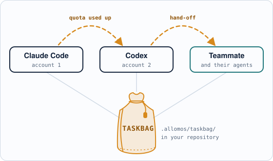
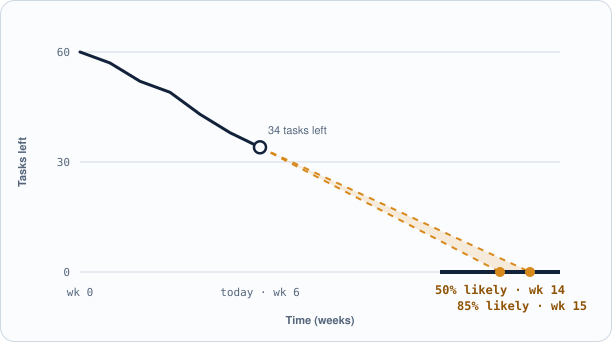

**English** · [简体中文](README.zh-CN.md) · [日本語](README.ja.md)


# Allomos

**Switch agents. Switch teammates. Keep the project.**

When one AI agent or account runs out, another picks up where it stopped. When you hand the work to a teammate, nothing stays behind in a chat. The project travels in its **taskbag**: plain files in your own repository.

<picture>
  <source media="(prefers-color-scheme: dark)" srcset="docs/images/readme/hop-en-dark.svg">
  
</picture>

`Local app · free` · `macOS · Windows` · `Claude Code · Codex` · `Cloud · optional, paid`

> **Status: early development.** v0.1, the macOS local tracker, is done; v0.2 (macOS and Windows, editing in the app) is in progress. Features below marked *(planned)* are not built yet.

## The problem: every switch loses the thread

Vibe coding runs on many sessions: Claude Code, Codex, several accounts, several people. A quota can end a session without warning, and the next one starts cold. The project's state lives in hand-kept Markdown and in people's heads. In one real multi-agent migration project (September 2026):

- **185 KB** of handoff notes that each new session re-read to resume;
- **6** places where one card's status was copied by hand;
- **3** sessions claiming cards at once, settled by merge conflict;
- **0** answers to "when will it be done?"

## What Allomos does: one main job, two that make it better

| | What it is for | |
|---|---|---|
| **Switch** (main set) | Shift the project between AI agents and teammates without losing anything. | A taskbag in your repository · the same commands for every agent · handoff and resume in one step · hand the project to a teammate |
| **AI skills** (set 2) | Get better at working with AI agents. | Learn each agent · switch cleanly · run the vibe-coding process · improve the results |
| **Progress management** (set 3) | See where the project stands and when it will land. | Progress by area · what waits on you · burndown and finish date · desktop, browser and phone |

All three sets work on the same taskbag.

### Switch between AI agents: Claude runs out, Codex picks up

- **A taskbag in your repo.** Tasks, proven steps and handoff notes live as readable files in `.allomos/taskbag/`, versioned by your own Git, not inside one agent's memory or one account.
- **The same commands for every agent.** Claude Code, Codex and others claim, update and release tasks with the `alm` command (MCP *(planned, v0.3)*).
- **Resume in one step.** A new session asks for the next task and gets its proven step and the last handoff note.
- **Start or reopen a session** in the agent you choose, straight from the task *(planned, v0.8)*.

```text
# Claude Code · account 1 · quota nearly used
alm label A01-03 "implemented"
alm release A01-03 --note "form done; tests next"

# Codex · account 2 · a minute later
alm next
A01-03  Sign-in page  ready · note: tests next
alm claim A01-03
```

### Switch between teammates: hand over the project, not a pile of notes

The same taskbag carries the work from you to a teammate and back. Each of you keeps your own agents, and everyone sees the same tasks. Every task carries **who holds it** (a person or an agent session), its **proven step** (implemented … owner verified), what it is **waiting on**, and its **handoff note**. In a shared repository the taskbag travels with Git at no cost; a cloud project adds live sharing, email invitations and roles *(planned)*.

### AI skills: get better at working with agents *(being designed)*

Learn what Claude Code and Codex are each good at and how to set one up for your project; what to hand over when a task moves to another agent or account; the vibe-coding process (one task per outcome, a working copy per session, proven steps, your approval before anything leaves your machine); and choosing the model and effort for each task. Later: an agent drafts a whole project, and Allomos checks and previews it before you adopt it.

### Progress management: know where it stands and when it lands *(planned, v0.4–v0.10)*

Progress by area with each task's proven step; the decisions only you can make, with the evidence; a finish date from your real pace (the date you have a 50% chance of hitting, and the date you have an 85% chance of hitting); at your desk, in a browser or on your phone, connected to your desktop app.

<picture>
  <source media="(prefers-color-scheme: dark)" srcset="docs/images/readme/glide-path-en-dark.svg">
  
</picture>

*An example of the forecast to come, not real data.*

## Pricing: free on your machine, pay only for the cloud

| Local app: **free** | Cloud: **optional** |
|---|---|
| No account, no card, no trial clock | Only if you want it; pricing to be announced |
| Switch between AI agents and accounts, by command line (and MCP, planned) | Switch between teammates live: a cloud copy on any computer |
| Desktop app for macOS and Windows | Team sign-in, email invitations and roles |
| Local projects in your own repositories | Live collaboration and merged edits |
| Burndown, forecast, and phone and browser at home | |

Your data stays local unless you choose to share it.

## Roadmap: 15 small releases, each one usable

| | Release | Set |
|---|---|---|
| Done | v0.1 macOS local tracker | switch |
| Now | v0.2 macOS + Windows, editing | switch |
| Next | v0.3 MCP for agents · v0.4 progress view · v0.5 burndown and forecast | switch · progress |
| Later | v0.8 start and open agents · v0.9 phone at home · v0.10 phone anywhere · v0.11 AI-generated projects | switch · progress · skills |
| Then | v0.13 cloud copy · v0.14 teams · v1.0 public release | switch |

Allomos tracks its own development with Allomos.

## For developers

- Run the app from source: [docs/workflow/CODING_RULES.md § Running the app](docs/workflow/CODING_RULES.md#running-the-app).
- Product plan: [docs/product/PLAN.md](docs/product/PLAN.md) · requirements: [docs/product/REQUIREMENTS.md](docs/product/REQUIREMENTS.md) · the three sets: [decision 0014](docs/decisions/0014-main-purpose-and-three-sets.md).
- What is being worked on now, and the owner's open questions: [docs/TASK_BOARD.md](docs/TASK_BOARD.md). The full task list lives in Allomos's own taskbag, kept in a separate repository that is private for now. Maintainers with access clone it beside this one (`../allomos-taskbag`) and run `alm list --taskbag "../allomos-taskbag/.allomos/taskbag"`, or open this repository in the Allomos app.
- All documentation: [docs/README.md](docs/README.md). AI agents start at [AGENTS.md](AGENTS.md).

## License

[MIT](LICENSE) © 2026 will.w.hui
