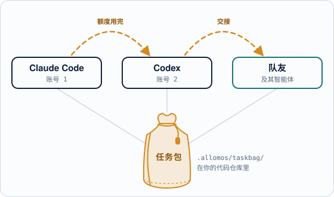
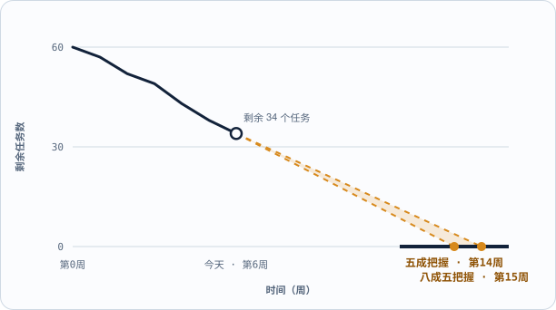

[English](README.md) · **简体中文** · [日本語](README.ja.md)


# 换肩 Allomos

**换智能体，换队友，项目全程有记录。**

一个 AI 智能体或账号的额度用完了，另一个从停下的地方接着做。每个任务、它的状态和交接笔记都记在同一个地方——项目的**任务包**（就是你自己代码仓库里的普通文件），而不是散落在各个对话中。

<picture>
  <source media="(prefers-color-scheme: dark)" srcset="docs/images/readme/hop-zh-CN-dark.svg">
  
</picture>

`本地应用免费` · `macOS · Windows` · `Claude Code · Codex` · `云端服务按需付费`

> **现状：早期开发中。** v0.1（macOS 本地任务跟踪）已完成；v0.2（macOS 和 Windows、应用内编辑）正在进行。下文标有 *（计划中）* 的功能还没有做。

## 痛点：Vibe Coding 的来龙去脉，散落在上百个对话里

一个项目要经过很多会话：Claude Code、Codex、好几个账号、好几个人。额度可能毫无预警地让会话中断，下一个会话只能从零开始。当初的决定只留在旧对话里，项目进度散落在手写的 Markdown 和每个人的脑子里。在一个真实的多智能体迁移项目里（2026 年 9 月）：

- **185 KB** 的交接笔记，每个新会话接手都得从头读一遍；
- **6** 个地方要手工同步同一张任务卡的状态；
- **3** 个会话同时抢任务，最后靠 Git 合并冲突来裁决；
- **0** 人能回答“到底什么时候能做完？”

## 「换肩」能做什么：四个亮点

| | 用来做什么 | |
|---|---|---|
| **切换** | 在 AI 智能体（和账号）之间、在队友之间交接项目，从停下的地方接着做。 | 所有智能体用同一套命令 · 一步交接，一步接手 · 把项目交给队友 |
| **任务管理** | Vibe Coding 的全过程完整记录：每个任务和它的状态都在一处，不分散在各个对话里。 | 便于人工审查 · 便于开发中维护，也便于今后长期维护 |
| **AI 技能** *（开发中）* | 和智能体合作，越做越好。 | 了解每个智能体 · 干净利落地切换 · 把 Vibe Coding 流程跑顺 · 提升产出质量 |
| **进度管理** *（开发中）* | 看清项目走到哪、什么时候落地。 | 按领域看进度 · 等你处理的事项 · 燃尽图和交付日期 · 桌面、浏览器、手机都能看 |

四项功能共用同一个任务包。

### 在 AI 智能体之间切换：Claude 额度用完，Codex 接着干

- **所有智能体用同一套命令。** Claude Code、Codex 等通过 `alm` 命令认领、更新、释放任务（MCP *（计划中，v0.3）*）。
- **一步接手。** 新会话领取下一项任务时，就能拿到它的验证阶段和上一条交接笔记。
- **一键启动智能体。** 从任务出发，在你选的智能体里开启新会话，或回到之前的会话 *（计划中，v0.8）*。

```text
# Claude Code · 账号 1 · 额度快用完
alm label A01-03 "implemented"
alm release A01-03 --note "form done; tests next"

# Codex · 账号 2 · 一分钟后
alm next
A01-03  Sign-in page  ready · note: tests next
alm claim A01-03
```

### 在队友之间切换：交出去的是项目，不是一堆笔记

同一个任务包把工作从你手里交给队友，再交回来。每个人用自己的智能体，大家看到的是同一批任务。每个任务都随身带着：**谁在负责**（某个人，或某个智能体会话）、**验证阶段**（已实现 … 已人工验证）、**在等什么**，以及**交接笔记**。在共用的代码仓库里，任务包随 Git 一起流转，不花一分钱；云端项目再加上实时共享、邮箱邀请和角色权限 *（计划中）*。

### 任务管理：没有什么藏在对话里

任务就是 `.allomos/taskbag/` 下可读的普通文件，用你自己的 Git 管理版本，不锁在某个智能体的记忆或某个账号里。任务包记下的是：

- **每个任务和它的状态**（就绪、进行中、等待、受阻、完成），集中在一处，同一时间只有一个负责者；
- **逐级验证的进展**：每个任务沿着阶梯往上走（已实现 → 本地验证 → 部署并验证 → 人工确认），进度靠证明，不靠口头声称；
- **交接笔记和 AI 自己做的决定**：做了什么、下一步是什么，以及智能体做过的每个日常选择，方便你事后审查；
- **你的待办清单**：需要你确认、回答或审查的事项，一张表全列出来。

几个月后，你或新来的队友回头看代码时，每处改动背后的原因都还在。

### AI 技能：和智能体合作，越做越好 *（开发中）*

了解 Claude Code 和 Codex 各自擅长什么，怎样为你的项目把它配置好；任务换到另一个智能体或账号时，该交接哪些东西；把 Vibe Coding 流程跑顺（一个成果一张任务卡，每个会话一份独立的工作副本，一级一级地验证，任何东西离开你的电脑前都要你同意）；为每个任务选合适的模型和推理强度。以后还能让智能体先起草整个项目，「换肩」检查并预览后再由你决定是否采用。

### 进度管理：走到哪了，何时落地，一目了然 *（开发中，v0.4–v0.10）*

按领域看进度，每个任务处在哪一级验证都清清楚楚；只有你能拍板的事项，连同依据一起列出来；按真实速度给出两个交付日期：有五成把握的，和有八成五把握的；在电脑前、浏览器里或手机上，连上你的桌面应用就能看。

<picture>
  <source media="(prefers-color-scheme: dark)" srcset="docs/images/readme/glide-path-zh-CN-dark.svg">
  
</picture>

*这是将来预测功能的示意图，不是真实数据。*

## 价格：本地免费用，用云端才收费

| 本地应用：**免费** | 云端：**按需** |
|---|---|
| 不用注册 · 不用绑卡 · 没有试用期限 | 需要时再开通 · 价格待定 |
| 在 AI 智能体和账号之间切换，通过命令行接入（MCP 计划中） | 和队友实时切换：项目存一份到云端，换台电脑也能接着用 |
| macOS 和 Windows 桌面应用 | 团队登录、邮箱邀请和角色权限 |
| 项目就放在你自己的代码仓库里 | 实时协作，修改自动合并 |
| 燃尽图、完成预测，在家可用手机和浏览器查看 | |

除非你主动分享，数据只留在你的电脑上。

## 路线图：拆成 15 个小版本，每一版都能用

| | 版本 | 功能组 |
|---|---|---|
| 已完成 | v0.1 macOS 本地任务跟踪 | 切换 |
| 现在 | v0.2 macOS + Windows、应用内编辑 | 切换 |
| 接下来 | v0.3 智能体专用的 MCP · v0.4 进度视图 · v0.5 燃尽图与完成预测 | 切换 · 进度 |
| 之后 | v0.8 从应用里启动智能体 · v0.9 在家用手机查看 · v0.10 出门在外也能用手机 | 切换 · 进度 · 技能 |
| 最后 | v0.13 云端存储 · v0.14 团队协作 · v1.0 正式发布 | 切换 |

「换肩」用自己来管理自己的开发。

## 开发者

- 从源代码运行应用：[docs/workflow/CODING_RULES.md § Running the app](docs/workflow/CODING_RULES.md#running-the-app)（英文）。
- 产品计划：[docs/product/PLAN.md](docs/product/PLAN.md) · 需求：[docs/product/REQUIREMENTS.md](docs/product/REQUIREMENTS.md) · 三组功能：[决定 0014](docs/decisions/0014-main-purpose-and-three-sets.md)（均为英文）。
- 当前在做什么、审批人待答的问题：[docs/TASK_BOARD.md](docs/TASK_BOARD.md)。完整的任务清单在「换肩」自己的任务包里，放在另一个仓库中，目前尚未公开。有权限的维护者把它克隆到这个仓库旁边（`../allomos-taskbag`），然后运行 `alm list --taskbag "../allomos-taskbag/.allomos/taskbag"`，或在「换肩」应用里打开这个仓库。
- 全部文档：[docs/README.md](docs/README.md)。AI 智能体从 [AGENTS.md](AGENTS.md) 开始。

## 许可证

[MIT](LICENSE) © 2026 will.w.hui（许可证原文为英文）
