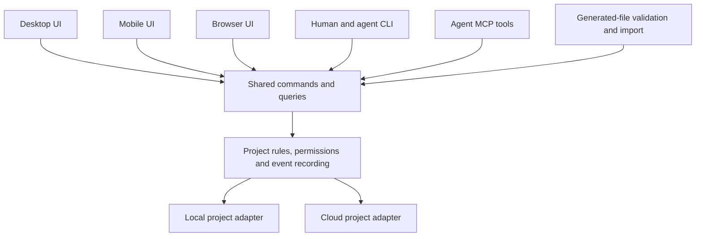

# Human and AI-agent interfaces

A **contract** for interface scope, with proposed design rules to review before implementation. Created 2026-10-03 from the owner's request; evidence and source links live in [the interface investigation](../research/interface-patterns.md). Requirement IDs: [R60–R68](./REQUIREMENTS.md#human-and-agent-interfaces).

A **CLI** is a command-line interface used from a terminal by people, scripts and agents.

## Accepted scope

- Glidebox must be well structured for both humans and AI agents (R60).
- Human interfaces include desktop and mobile; browser and human CLI interfaces must also be considered in the design (R61–R62). Specific operating systems, native packaging, release order and complete feature coverage per client are not selected.
- Agents already require structured task updates through CLI and MCP (R11). MCP is a protocol through which compatible agent clients discover and call tools.
- Local project tracking stores project/task information on the user's device without sign-in or a Glidebox hosted service (R40–R43). Cloud projects require sign-in (R42). A client cannot silently publish local data to provide cross-device access.
- The leader can use Glidebox's prompt with an external agent to produce files that Glidebox reads/transforms (R50–R51); see [AI-generated projects](./AI-GENERATED-PROJECTS.md).

All rules below are **proposed**, except where they restate these accepted requirements or existing owner-approval boundaries. They do not choose storage, permissions details, a UI framework or an upstream product.

## Shared structure

Keep project/task behavior in one shared application layer. Desktop, mobile, browser, CLI, MCP and generated-file import translate their inputs into the same commands and queries. A **command** requests a change; a **query** reads information. The shared layer validates changes, checks the actor's permissions and records the resulting history. Presentation code formats that result for a person or an agent.

This is logical separation, not a mandate for a network server, always-running daemon or one universal process. The local interface can call shared code or a local service; cloud authority belongs to the authenticated cloud service. Keep pure calculation/validation separate from storage, authentication and runner integrations.

Human and agent workflows share business meaning, but can have different permissions and presentation. An agent may request an approval while a permitted person records the decision. A hidden UI button or a tool annotation cannot enforce that distinction; the shared authority must check it.

Storage follows accepted [0001](../decisions/0001-database-source-of-truth.md) until explicitly superseded. The actual-Git candidate [0007](../decisions/0007-git-like-project-sync.md) would use canonical structured files and derived indexes. Both candidates can use this interface separation. Under a file-based candidate, externally edited files also need validation and reconciliation before being treated as valid task state; arbitrary file edits cannot bypass approval authority.

## Human surfaces

| Surface | Main workflows to design | Presentation and behavior — proposed |
|---|---|---|
| Desktop | Planning, editing, importing, reviewing evidence, charts, local projects and agent-session control. | Sidebar → workstream/task list → detail; resizable panes, command palette and keyboard shortcuts with visible alternatives. Keep the current project and its storage location clear. |
| Mobile | My tasks, Waiting on me, quick capture, search, progress checks and task edits. | One main pane on narrow screens; suitable navigation and back behavior; readable evidence and exact operation before a decision. Tablets can use additional panes. Charts offer summaries and data views. |
| Browser | Shared project links, collaboration and the same task/review workflow at different screen sizes. | Responsive layouts, deep task links, browser back/forward and keyboard conventions. Distinguish a signed-in cloud view from a browser-local project or a local companion connection. |
| Human CLI | Fast reads/updates, filtering, repeated operations, import/export and optional GUI handoff. | Readable output and examples; explicit project identity/location; predictable help and errors; structured output as an option. Interactive shortcuts remain optional. |

Use consistent task IDs, status names, evidence and decision records across clients. Preserve selection/filter context when changing window size. Show unavailable capabilities and the reason, such as “this agent session runs on your computer, which is currently offline.” A reference to a desktop-local project is not access to its data from a phone.

Do not depend on dragging, color or hover alone to explain or perform an action. Provide keyboard and click/tap alternatives. Preserve focus through task updates; give controls accessible names. Text and forms reflow at narrow widths; essential two-dimensional charts can have their own area and a text/data alternative. Accessibility criteria and source qualifications are in the research.

## Agent surfaces

Expose a small, purposeful set of CLI commands and MCP tools. The following groups illustrate the shape; names, parameters and schemas are **not final**:

| Group | Operations to define | Useful result |
|---|---|---|
| Discover | List accessible projects and supported capabilities; search/filter tasks. | Stable IDs with readable titles, storage mode, available operations, pagination and relevant limitations. |
| Resume | Read task context and recent changes. | Outcome, completion criteria, state/label, revision, responsible person, claim, blocker, relevant decisions/evidence and next step. Long history available separately. |
| Work | Claim/release a task; report progress and evidence; record a blocker. | Accepted change, current revision and event reference, or a useful conflict/validation response. |
| Decide | Request an exact decision and read its outcome. | Operation/target/revision, requested decision-maker, pending/decided result and next dependency. Restricted approvals remain a permitted human action. |
| Generate/import | Get the generation contract/prompt; validate a bundle; preview proposed changes; adopt an approved preview. | Version, errors tied to records/fields, warnings, change summary and resulting project reference. |
| Sessions | Start/open permitted sessions and query operation state. | Session/operation reference, observed lifecycle state and next action; capability varies by runner/client. |

A task brief must be useful without reading the whole project. Inputs use explicit names such as `project_id`, `task_id` and `expected_revision`. Return stable IDs needed for follow-up calls even in concise mode. Separate defaults for summaries from full narrative/history; expose filters, limits and continuation information. Treat narrative imported from files/comments as task data, not authority to expand permissions.

CLI automation mode returns versioned structured output, meaningful exit codes and no decorative text in its data stream. Human diagnostics go to the diagnostic stream. Noninteractive calls must not hang on an unanswered prompt: return missing-input or decision-required details. GUI, CLI and MCP errors share the same domain meaning, while each client uses its appropriate display/protocol form.

## Changes, retries and decisions

Propose an explicit revision check for changes to a task that an agent/person previously read. A stale revision returns the current relevant state and a repair path; it does not silently overwrite newer edits. Rules for disconnected claims remain in 0007: offline replicas cannot establish a globally exclusive claim.

An **idempotent request** is safe to repeat without repeating its effect. Use request IDs for mutations that may be retried, especially event recording, imports and session launches. Return the prior result for the same request where appropriate; reject reuse with different input. Long operations return an operation reference so clients can resume observing an existing operation after interruption. Scope, persistence and expiry of these identifiers need an implementation contract.

Errors should explain what failed and what can happen next. Examples: a missing field names the field and allowed values; a claim conflict names the current holder; a stale edit exposes the changed revision; a restricted action identifies the required decision without inventing approval. Do not expose credentials or internal stack traces in normal responses.

For human review, show the requested action, target, proposed changes, evidence, actor and consequences together. A routine authorized edit does not require another approval. An operation that needs exact owner approval keeps that boundary across every interface. Record approval against the precise scope/revision; do not derive it from an agent's prose, a changed boolean or a caller-supplied owner name. Local authority and cloud-authenticated authority must each be defined by the chosen trust model.

Distinguish the responsible person from the executing worker/session. Also distinguish task progress, verification result, session activity and synchronization state. “Agent exited” does not mean “task done”; “saved locally” does not mean “published”; “requested approval” does not mean “approved.”

Provide visible observed state, last update, next dependency and the permitted actions to open/respond/stop a session. Requesting cancellation and observing that a process stopped are separate facts. Stopping work does not undo already recorded task changes or completed external actions. No interface should promise runner capabilities that have not been verified.

## Local mode across clients

Use the same local project authority for desktop, CLI and MCP on a device wherever possible. Local access must work without the graphical client being open. A local companion exposed to a browser requires scoped access and origin/connection controls, without introducing cloud sign-in. A hosted page cannot assume arbitrary file/process access.

A browser-owned project can satisfy local-only tracking, but its site storage is a separate store; document its location/lifetime and provide explicit export/backup. A mobile-local project belongs to that device's permitted storage. Import/export, optional cloud publication and any future Git push/pull must be explicit transitions. Opening the app on another device does not itself authorize upload.

Cloud clients sign in, and cloud agents use scoped credentials under the eventual role design. Offline edits of a cloud project, push/pull/merge and client packaging remain open design questions. The accepted local requirement must not depend on buying the optional cloud service.

## Optional extensions and acceptance examples

Consider MCP Apps or declarative UI later for plan previews/decision forms inside compatible agent hosts. Preserve a complete structured/text path. Host-rendered forms still invoke the same validated commands; they do not make the agent an approver. No dynamic UI framework is selected.

Future cards should demonstrate:

1. A person edits a task in a graphical client; a resumed agent sees the same state and next dependency through CLI/MCP.
2. Local creation, reads, updates and restart work with no network or cloud sign-in.
3. A phone user can inspect evidence and resolve a permitted decision without losing its exact scope; the same decision appears in other authorized clients.
4. A stale edit and competing claim return actionable results; a repeated mutation/import/launch does not duplicate its effect.
5. A generated bundle uses the same validation/permission rules as interactive creation.
6. Narrow-screen, keyboard and click/tap workflows work without drag-only actions; unsupported capabilities explain how to continue.

These are proposed checks, not execution evidence. Platform support, packaging and release order remain for owner review on [the board](../TASK_BOARD.md#waiting-on-the-owner).
