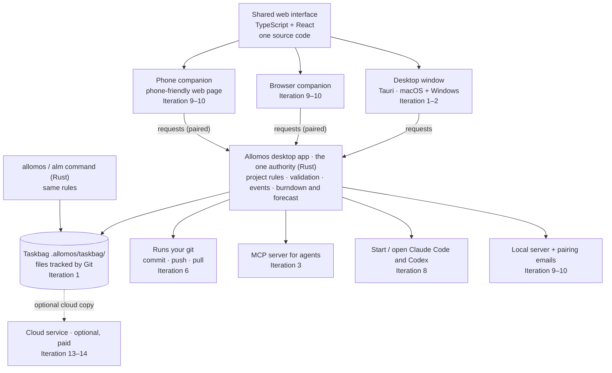

# Allomos — plan

> Status: **draft, first written 2026-09-27, last revised 2026-10-04.** Decisions marked *proposed* are recommendations awaiting the owner's confirmation. Full records: [decisions/](../decisions/README.md); requirements: [REQUIREMENTS.md](./REQUIREMENTS.md); discussions: [all records](../README.md#discussions). Allomos is developed by AI agents following [AGENTS.md](../../AGENTS.md).

## 1. Problem

**Main purpose (owner, 2026-10-06, [0014](../decisions/0014-main-purpose-and-three-sets.md)):** Allomos lets a project switch between AI agents (and their accounts) and between teammates without losing anything. AI skills and progress management are the two other sets of features. The problems below are the costs of switching today.

Work is carried out by several AI coding sessions (Claude Code, Codex) in parallel worktrees, plus the owner and teammates. Today the state of that work lives in hand-maintained markdown (reference: the Joyns SSR migration `TASK_BOARD.md` + `workstreams/` card files). That approach has these costs:

1. **Status is duplicated** across the card file, card index, Now, Timeline gantt, recently-finished table and area table — agents must keep six copies in sync, and they drift.
2. **Status is prose.** Labels such as "locally verified; owner verified, Done (test Worker not redeployed)" cannot be counted, filtered or charted.
3. **The owner is the bottleneck but has no queue.** Most open cards wait on an owner check or an exact approval; that is scattered across "Next dependency" cells.
4. **Claiming is manual.** Sessions claim cards by committing to a registry and resolving merge conflicts.
5. **No forecast.** Estimates exist only per workstream in person-weeks and are not tied to cards; the full scope (roadmap cards) is not on the board; nothing answers "when will we finish?"
6. **Expensive context.** Agents read tens to hundreds of KB of markdown to resume.
7. **No collaboration.** Teammates cannot see or update anything outside the repo.

## 2. Goals

- See every task's **state and progress**, **grouped by area**, as **lists and charts**.
- A **burndown chart** with an **estimated finish date** (a range, not a single guess).
- **A free local app** ([D12](../decisions/0012-free-local-app-paid-cloud.md)): developers and team leaders can use the desktop app on their own computer free of charge, with no account; paying is optional and only for cloud features.
- **Purely local projects**: project and task information stays on the user’s machine; no sign-in or hosted service is required for tracking.
- **Optional cloud projects**: users choose cloud storage and collaboration; teammates sign in, see live updates, and act on tasks.
- **Agents are first-class users**: Claude and Codex sessions claim, update and release tasks through a CLI / MCP server, cheaply, with one holder per task (R12).
- **A desktop app as the hub**, with the full feature set. Web and mobile companion apps connect to the running desktop app to view projects, including progress and status ([D9](../decisions/0009-desktop-hub-with-web-and-mobile-companions.md), R69–R71).
- **Interfaces for people and agents**, with desktop/mobile human use and browser/human CLI considered in the design. Shared structure and platform patterns are documented in [INTERFACES.md](./INTERFACES.md) (R60–R68; detailed design proposed).
- A **"waiting on me"** inbox for checks and approvals owed by a person.
- **Import** the existing SSR migration board as the first real dataset.
- **Generate project setup with an external AI agent:** a team leader supplies Allomos’s prompt and team context; Allomos reads/transforms the resulting project/task files ([feature contract](./AI-GENERATED-PROJECTS.md), R50–R51).
- **Start a task in a chosen AI agent** (Claude Code, Codex) from the app, and **jump into** an already-started task's agent session ([D5](../decisions/0005-start-and-open-agent-sessions.md)).

## 3. Non-goals (for now)

- Orchestrating agents automatically (scheduling, auto-assigning, chaining agents). Allomos starts an agent only when a person asks it to.
- Replacing git, PRs or CI. Allomos links to them.
- Storing secrets, credentials or evidence logs. Cards link to evidence; they do not hold it.
- Full project-management features (budgets, time sheets, resource leveling).
- Several Allomos projects inside one code repository ([D10](../decisions/0010-project-data-folder.md)); special handling for synced folders, network drives or removable disks.

## 4. Decisions

| # | Decision | Status |
|---|---|---|
| [D1](../decisions/0001-database-source-of-truth.md) | ~~The database is the source of truth.~~ Agents write structured fields through the CLI/MCP; hand-maintained markdown boards come in through an importer. | **superseded by D7, 2026-10-04** |
| [D2](../decisions/0002-burndown-counts-plus-sizes.md) | **Burndown uses task counts, plus optional sizes.** Every task counts as 1; a task may carry an optional size (points or days), and the chart can switch to size-weighted when sizes are present. | **accepted 2026-09-27** |
| [D3](../decisions/0003-relationship-to-glidelines.md) | **Relationship to Glidelines.** Allomos is a **new standalone product**: its own repository, stack and file format; no shared library. Glidelines (`glidepace-vibe-cc`) is a read-only reference whose burndown and forecast ideas are rewritten here in Rust. | **accepted 2026-10-06 (B)** |
| [D4](../decisions/0004-team-accounts-and-roles.md) | **Cloud team accounts with roles**: owner, admin, approver, contributor, viewer, and agent (token-based, scoped to a project). **An owner or admin adds members by email address**; no public sign-up. | **roles and email invites accepted 2026-09-27**; role details proposed |
| [D5](../decisions/0005-start-and-open-agent-sessions.md) | **Start and open agent sessions from Allomos**, through a local runner daemon (`alm runner`) on a person's machine or a vendor cloud session. | **requirement accepted 2026-09-27**; design proposed |
| [D6](../decisions/0006-local-and-cloud-projects.md) | **Local-only and optional cloud projects.** Local tracking stores data on the user’s machine without sign-in; cloud projects require sign-in. Storage technology and transfer/sync design remain open. | **requirement accepted 2026-10-01** |
| [D7](../decisions/0007-git-like-project-sync.md) | **Git with readable text files is the source of truth.** JSON fields and Markdown narrative in the taskbag; a database is only a rebuildable index; push/pull/merge with a cloud copy. | **accepted 2026-10-04**; sync and merge details proposed |
| [D8](../decisions/0008-build-our-own.md) | **Build our own.** No open-source tracker (e.g. Backlog.md) is used as a base or fork; they are references only. | **accepted 2026-10-04** |
| [D9](../decisions/0009-desktop-hub-with-web-and-mobile-companions.md) | **Desktop app is the hub.** Full features on desktop; web and mobile companions connect to the running desktop app to view progress and status. | **requirement accepted 2026-10-04**; design open |
| [D10](../decisions/0010-project-data-folder.md) | **User-chosen taskbag.** Each local project's data lives in a folder the user picks: standalone, or a subfolder of an existing project folder such as a code repository. | **requirement accepted 2026-10-04**; details proposed |
| [D11](../decisions/0011-desktop-framework-and-shared-code.md) | **Desktop for macOS and Windows; one shared interface code base.** Desktop window, browser and phone use the same web UI; only the desktop adds native parts. Framework: **Tauri 2**. | **accepted 2026-10-04** |
| [D12](../decisions/0012-free-local-app-paid-cloud.md) | **Free local app; payment only for the cloud.** | **accepted 2026-10-04**; paid features and source licence open |

## 5. Data model (first cut)

- **Project** — storage mode (`local | cloud`), taskbag (local projects: any folder the user chooses, standalone or inside an existing project folder — [D10](../decisions/0010-project-data-folder.md)), name, label ladder (configurable; SSR default: `implemented → locally verified → connected → deployed and verified`), forecast settings.
- **Area** — `id` (e.g. `W07`), title, order, optional estimate (low / likely / high). *What area of work* a task belongs to; stable for the life of the project.
- **Iteration** (R89) — `id`, title, order, optional start/end dates and the release it produces. *When* a task is planned; optional. A task has one area and at most one iteration. The words "area" and "iteration" can be renamed per project (R90).
- **Task** — hierarchical id (`A01-01-02`), title, area, parent, and:
  - `state`: `backlog | ready | in_progress | waiting | done | dropped`
  - `label`: current step on the project's ladder
  - `claimed_by`: one actor (agent session or person), with claim time
  - `waiting_on`: what blocks the next step — `owner_check | approval | task | external` + who + note
  - `size` (optional), `depends_on[]`, `links[]` (card file, branch, PR, commits, deploy URL)
  - narrative fields: outcome, done-when (markdown, short)
- **Approval** — task, exact operation requested, requester, decided by, decision, time.
- **Event** (append-only) — every change of state, label, claim, size or scope, with actor and timestamp. **Burndown, timeline and "recently finished" are all computed from events**, never maintained by hand.
- **Member** — person or agent in a project, with a role; **Invitation** — email, role, inviter, expiry, state.
- **Runner** — a registered machine (local daemon) or cloud connection that can launch agents; owner, allowed projects/repos/members, liveness.
- **Agent session** — agent (Claude / Codex), runner, task, session id, worktree, branch, resume command or URL, state (running / waiting for input / exited).
- **Actor** — person or agent session (`codex/w09-help-contact`, `claude/task-w07-01-09-…`), provider, owning person.

## 6. Views

1. **Area list** — tasks grouped by area, with state, label, claim and waiting-on; filters by state, actor and waiting-on.
   The same list can be grouped **by iteration** instead, with unplanned tasks last (owner, 2026-10-08; [`A01-15`](../tasks/Task-A01-15-iterations-view.md)).
2. **Board** — columns by state (or by label).
3. **Waiting on me** — every check/approval owed by the signed-in person; one click to approve, reject or mark checked.
4. **Progress charts** — per-area done/open bars, state distribution, throughput per week.
5. **Burndown + forecast** — see §7.
6. **Timeline** — gantt generated from claim and done events.
7. **Task detail** — a pane beside the list (owner, 2026-10-08): fields, description and links, event history ([`A01-16`](../tasks/Task-A01-16-task-pane.md)).
8. **Sessions** — which agent sessions hold which tasks right now, and whether they are alive (replaces the session registry).
9. **Start in agent / Open session** — buttons on every task (see [D5](../decisions/0005-start-and-open-agent-sessions.md)).

### AI-generated project setup

The leader gets an Allomos prompt, asks their chosen external agent to generate a project bundle, then opens/imports it in Allomos. Proposed flow: validate → preview → repair errors → accept locally → optionally publish after sign-in. The prompt/schema and adoption details are proposed in [AI-GENERATED-PROJECTS.md](./AI-GENERATED-PROJECTS.md). This path does not require the in-app agent runner or cloud access.

### Human and agent interfaces

Desktop/mobile human use is accepted; browser and human CLI must be considered. Proposed presentation: task list/detail and review panes on wide screens; My tasks, Waiting on me, quick capture and full-screen task detail on phones. CLI/MCP provide structured discovery, context and task operations for agents. All supported surfaces should use shared project rules and recorded history. [Interface contract](./INTERFACES.md) and [internet investigation](../research/interface-patterns.md) include platform tradeoffs, accessible interaction, agent tool patterns and the distinction between device-local and cloud access. Packaging direction is now set by [D9](../decisions/0009-desktop-hub-with-web-and-mobile-companions.md): a desktop hub with web and mobile companions. Operating systems, the mobile form and release order remain open.

## 7. Burndown and forecast

- **Lines:** remaining tasks and total scope over time (scope growth is visible, not hidden); the size-weighted variant when sizes exist.
- **Forecast by throughput:** sample the tasks finished per week over the last N weeks (default 4–6) and run a Monte Carlo simulation of the remaining count → finish dates at **50% / 85%** confidence, drawn as a cone.
  - **Wording on screen:** always show the chance with the date, for example "50% chance of finishing by 12 Nov" and "85% chance by 26 Nov" (Chinese: "有五成把握在 11 月 12 日前完成"). Never show a bare "50%": readers took it for team efficiency (owner question, 2026-10-04).
- **Forecast by estimate** (secondary): remaining size ÷ capacity, with remaining percentage by state (as in Glidelines: to do 100%, in progress 50%, waiting 20%).
- **Missing history:** for imported tasks without completion dates, reuse Glidelines' reconstructed-band approach instead of inventing dates.
- Optional target date line and "on track / at risk" indicator.

## 8. Architecture (proposed)

### At a glance (updated 2026-10-04)

- **One interface code base** runs in the desktop window, a browser and a phone ([D11](../decisions/0011-desktop-framework-and-shared-code.md), [D9](../decisions/0009-desktop-hub-with-web-and-mobile-companions.md)). It only displays results and sends requests.
- **The desktop app is the one authority.** Its Rust code checks every change, records it as an event, and owns the native parts. Companions' actions, such as approvals, are requests that the desktop app checks and applies (R77).
- **The `alm` command** uses the same Rust rules on the same taskbag.

**Open points:**
1. **How the interface reaches the Rust side inside the desktop window.** The proposal is the same kind of connection a browser will later use, so the interface never changes. Iteration 1 has no local server yet (it arrives in Iteration 9), so [`Task-A01-01`](../tasks/Task-A01-01-walking-skeleton.md) picks a first connection that can switch over later without rewriting the interface.
2. **Two writers on one taskbag.** In Iteration 1, both the desktop app and `alm` can change the same `.allomos/taskbag/`. "One writer at a time" (R75) needs a mechanism, for example a lock file or `alm` passing changes through the running desktop app. The `alm` command card decides this.

### Details

- **Interface separation:** human clients, CLI, MCP and generated-file import call shared application commands/queries for permissions, validation and event recording, above local/cloud storage adapters. `crates/core` retains pure model/calculation rules; the application layer owns side effects. Desktop/mobile presentation and platform capabilities adapt around this shared behavior; layout, framework and process boundaries remain open ([INTERFACES.md](./INTERFACES.md)).
- **Desktop hub** ([D9](../decisions/0009-desktop-hub-with-web-and-mobile-companions.md)): one desktop application holds the local project store, runs the shared commands, and hosts a **local server** for the web and mobile companions. The CLI, MCP server and agent runner talk to the same local authority. It ships for **macOS and Windows**, and its window shows the **same web interface** that it serves to browser and phone companions; only the desktop adds native parts ([D11](../decisions/0011-desktop-framework-and-shared-code.md)). Framework: **Tauri 2** (owner, 2026-10-04); macOS and Windows released together; unsigned builds until the first public release.
- **Monorepo — Rust workspace + TypeScript interface** ([D11](../decisions/0011-desktop-framework-and-shared-code.md)). Proposed layout; the first code card confirms it:
  - `crates/core` — Rust: domain model, validation, events, burndown and forecast (pure, unit-tested; the one authority for project rules)
  - `crates/store` — Rust: reads and writes the project's user-chosen taskbag ([D10](../decisions/0010-project-data-folder.md)) as Git-tracked JSON/Markdown files (D7); runs the `git` command; keeps the rebuildable index outside the folder
  - `crates/cli` — Rust: the `allomos` command (alias `alm`, R88) for people and agents (`alm claim`, `alm label`, `alm wait`, `alm done`, `alm release`, `alm next`)
  - `crates/mcp` — Rust: MCP server (official `rmcp` SDK) exposing the same operations to Claude Code and Codex
  - `crates/runner` — Rust: starts and resumes agents, creates worktrees, reports session state
  - `crates/importer` — Rust: Markdown board → Allomos (first target: the SSR `TASK_BOARD.md` + `workstreams/`; SSR workstreams become areas) and AI-generated bundles
  - `apps/desktop` — Tauri 2 app for macOS and Windows: wraps the crates above, hosts the local server for companions, shows `apps/web` in its window
  - `apps/web` — TypeScript + React + Vite + Tailwind interface (charts, lists, inbox); runs in the desktop window and is served to browser and phone companions; displays results and sends requests, holds no project rules
  - `supabase/` — cloud side (proposed): sign-in, roles, atomic claims and the cloud project index; how it hosts the Git remote is open under D7
- **Storage modes ([D7](../decisions/0007-git-like-project-sync.md)):** local projects are Git-tracked text files in a user-chosen taskbag, with a rebuildable index outside it. Cloud projects are a hosted copy (a Git remote with server-side permission checks) and require sign-in. The domain model and event rules must work in both modes. Local tracking cannot depend on cloud authentication or hosted services. The index technology remains open.
- **Cloud backend (proposed):** Supabase — Postgres, Auth (cloud sign-in), Row Level Security per project and role, Realtime for live updates. Cloud agents use scoped project tokens; local agent access must work without a cloud token.
- **Transfer and sync:** moving/copying a local project to the cloud, offline cloud edits, and two-way synchronization remain open; do not assume automatic uploads.
- **Hosting:** to decide (Vercel or Cloudflare).
- **Agent instructions:** a short `AGENTS.md` / `CLAUDE.md` snippet telling sessions to resume with `alm next` and report with `alm` instead of editing board markdown.

## 9. Roadmap — releases

**Rapid iteration (owner, 2026-10-04; the 15 iterations confirmed the same day).** Iterations are numbered 1–15; each ends in a release (v0.1 … v0.14, then v1.0). Allomos grows from a small prototype. **Every release is a usable product**: an installable desktop app (macOS and Windows; unsigned builds until v1.0) that someone can use for real work, and that the next release extends. Each release is built as thin end-to-end slices: interface → Rust rules → files in the taskbag. No release is "only a library" or "only a backend". Agents and the owner use each release on real projects (Allomos itself, the SSR migration) before the next one starts, and what they learn can reorder the later releases.

**Now / Next / Later** — iterations kept small (owner, 2026-10-04): each adds one visible capability to an app that already works.

| Phase | # | Release | Usable for | What ships (products and contents) | Requirements |
|---|---|---|---|---|---|
| **Now** | **1** | **v0.1 — macOS local tracker** (prototype) | The owner tracks **Allomos's own development tasks** on a Mac; the agents building Allomos update them from the terminal | **macOS desktop app** (Tauri, unsigned): opens or creates the taskbag (standalone or inside a repo), tasks grouped by area with state, label, holder, waiting-on and next dependency (**view only in the app**; tasks are created and changed with the CLI), every change recorded as an event in Git-tracked JSON/Markdown files · **`allomos` CLI** (short alias `alm`) for macOS: `init`, add, list, show, claim, label, wait, done, release · **file format v1** · Allomos's own cards moved in from Markdown · *no server* | R91, R1, R2, R7 (events), R10, R11 (CLI), R12 (local), R13, R14, R25, R40–R41, R62 (human CLI), R69, R72–R75, R82, R86, R87–R88, R89 (optional iteration field) |
| **Next** | **2** | **v0.2 — macOS + Windows** | The same, on **Windows** as well, and the owner **creates and edits tasks in the app** | **Windows desktop app** and **`allomos` / `alm` CLI** for Windows · one build pipeline producing both systems' builds ([`A07-02`](../tasks/Task-A07-02-build-pipeline.md)) · fixes for Windows differences (paths, line endings, the WebView2 engine) ([`A07-03`](../tasks/Task-A07-03-windows-works.md)) · **tasks grouped by iteration**: tasks get an optional iteration, set with `alm`; the list switches between by area and by iteration ([`A01-15`](../tasks/Task-A01-15-iterations-view.md), first) · **task pane** beside the list with one task's details ([`A01-16`](../tasks/Task-A01-16-task-pane.md)) · **create and edit tasks in the app** (both systems), recorded as events like CLI changes ([`A01-17`](../tasks/Task-A01-17-change-history.md) history, [`A01-18`](../tasks/Task-A01-18-edit-task-in-app.md) edit, [`A01-19`](../tasks/Task-A01-19-create-in-app.md) create) · exit check on a Mac and a workmate's Windows machine ([`A07-04`](../tasks/Task-A07-04-v0-2-exit-check.md)) | R81, R85 (released together from here on), R1–R2 (editing in the app), R89 (iterations) |
| **Next** | **3** | **v0.3 — MCP for agents** | Claude Code and Codex use Allomos through **MCP tools**, not only shell commands | **MCP server** (`alm mcp`, started by the agent on the same computer); safe retries and stale-edit checks; `alm init` and the app switch the server on in the project's `.mcp.json`, and the server sends instructions that tell agents when to use it (owner, 2026-10-07) | R11 (MCP), R63–R65 |
| **Next** | **4** | **v0.4 — Progress view** | The owner sees **how far each area has got** and **what is waiting on them** | Desktop app: per-area progress bars, state distribution, weekly throughput, "waiting on me" list | R3, R24 (local), R89–R90 (views per iteration, renamed terms) |
| **Next** | **5** | **v0.5 — Burndown and forecast** | The owner sees **when the project will likely finish** | Desktop app: burndown (task counts, optional sizes, scope line) and a 50% / 85% finish-date range | R4–R6 |
| **Later** | **6** | **v0.6 — Git in the app** | The owner **commits and pushes task changes** without leaving Allomos | Desktop app: Git panel (status, diff, commit, push, pull through the `git` command; asks to install `git` if missing); the app refreshes when agents change files | R76 |
| **Later** | **7** | **v0.7 — Import the SSR board** | The owner tracks the **SSR migration** in Allomos | SSR importer (in the app and `alm import`) with a reconciliation report | R15 |
| **Later** | **8** | **v0.8 — Start and open agents** | The owner **starts a task in Claude Code or Codex from Allomos and jumps back into it** | Desktop app: "Start in agent", "Open session", session status (running / waiting / exited) | R30–R33, R66 |
| **Later** | **9** | **v0.9 — Companions at home** | The owner **views progress from a phone or another computer on the same network** | Desktop app's **local server**; **web companion** and **phone companion** (the same web interface, served by the desktop); pairing by email and long code (free email service, needs approval); "start the desktop app" message when it is off | R62 (browser), R67–R68, R70–R71, R79–R80, R83–R84 |
| **Later** | **10** | **v0.10 — Companions anywhere** | The owner **approves things from the phone, also away from home** | **Remote-access link** (free tunnel or relay service, needs approval); companions send actions to the desktop, which checks, applies and records them | R77–R78 |
| **Later** | **11** | **v0.11 — New projects in minutes** | A team leader **sets up a new project with any AI agent** | **Generation kit** (prompt, file schema, examples); desktop app validates, previews and adopts generated projects | R50–R55 |
| **Later** | **12** | **v0.12 — Timeline and export** | The owner sees a **timeline** and can **share a Markdown report** | Desktop app: timeline (gantt) generated from events; Markdown export | R8 |
| **Later** | **13** | **v0.13 — Cloud copy** | The owner **keeps a project in the cloud and works on it from two computers** | **Cloud service**, the first hosted server: sign-in, publish, clone, push and pull a project; **cloud web app** (the same web interface) | R42–R43, R92 (first paid features) |
| **Later** | **14** | **v0.14 — Team** | A team **works on one project together online** | Cloud service: owner/admin invitations by email, roles, live updates, merging concurrent edits, atomic cloud claims | R12 (cloud), R20–R23 |
| **Later** | **15** | **v1.0 — Public release** | Anyone can **download and install** Allomos | **Signed installers** (macOS `.dmg`, Windows installer), **auto-update feed** (GitHub Releases), download page and user guide, UI languages | R85 (signing), R61 |

**When can an agent set up a project's taskbag?** (`alm init` = "set up Allomos here", like `git init`)
- **From Iteration 1 (v0.1, macOS; Windows from Iteration 2).** An agent runs `alm init` in a repository; this creates an empty taskbag. It then adds areas and tasks one by one with `alm` commands. The desktop app can also create the folder.
- **From Iteration 11 (v0.11).** An agent generates a **whole project at once** from Allomos's prompt, and Allomos validates and previews it before adopting it (R50–R55).

**Taskbag place on disk (owner, 2026-10-04; renamed and made the only place 2026-10-06, [0013](../decisions/0013-product-name-fliphopper.md)):** `.allomos/taskbag/` at the root of the folder the user picks, like `.github/` or `.vscode/`, also when that folder is empty. `alm init` and the app both create it there (R72, R87).

**Every release** follows R60: one shared set of rules and commands serves people and agents alike.

**Exit check for each iteration** (how we know it is usable):

1. On a Mac:
   - create the taskbag in a new folder, and inside a Git repository;
   - add areas and tasks with the CLI (`alm add …`), and see them in the app;
   - a real Claude Code session claims and finishes a task with `alm`, and the app shows it;
   - `git diff` shows readable changes;
   - Allomos's own cards now live in its taskbag, and agents use `alm` instead of `TASK_BOARD.md`.
2. The same checks pass on Windows; one pipeline builds both systems; on both systems, a task created and edited in the app appears in `alm list` and in `git diff` as readable changes.
3. Claude Code and Codex each claim and update a task through MCP; repeating a request does not repeat its effect.
4. Progress bars, state chart and throughput match a known test project; "waiting on me" lists exactly the owner's items.
5. The burndown and the finish-date range show for Allomos's own project; the calculations are checked with fixed test data.
6. Committing from the app runs the user's own `git`, including hooks; a refused commit shows the hook's message.
7. The SSR board imports with every card accounted for in the reconciliation report.
8. From the app, start one task in Claude Code and one in Codex; the status shows; "Open session" jumps in.
9. A phone on the same network pairs by email code and shows progress; with the desktop app closed it shows the "start the desktop app" message.
10. A phone away from home approves a waiting item; the desktop applies and records it.
11. An agent generates a project from the kit; Allomos validates, previews and adopts it; a broken bundle changes nothing and gets clear errors.
12. The timeline and the Markdown export match the project's events.
13. A project published from one computer is cloned on another; changes push and pull both ways.
14. A teammate invited by email signs in and edits; conflicting edits are merged, or the user is asked.
15. Signed installers install without warnings; the app updates itself from one version to the next on both systems.

**Rules for the roadmap**

- **Only "Now" is committed.** "Next" and "Later" are direction and may be reordered after each release, based on what using it teaches. Reordering is the owner's decision.
- **No dates.** Agents' capacity is not yet known; the roadmap shows order and outcomes, not deadlines. Forecasts come from Allomos itself once Iteration 5 exists.
- **Each release reserves room for fixing and tidying**: about a fifth of its work goes to the problems found in the previous release.
- **Dependencies to watch:**
  - Iteration 2's exit check runs on **a workmate's Windows machine** (owner, 2026-10-04). The agent prepares an unsigned Windows build and a short step-by-step check list. The workmate installs it, runs the checks and reports the results, which are recorded on the card. Expect a Windows security warning on install, because builds are unsigned until Iteration 15.
  - Iteration 8 needs the agent launch research ([`A03-01`](../tasks/Task-A03-01-agent-launch-research.md)).
  - Iterations 9–10 need the remote-access and email research ([`A04-01`](../tasks/Task-A04-01-remote-access-research.md)), and owner approval to create the email-service (9) and tunnel (10) accounts.
  - Iteration 13 needs the cloud hosting choice and approval for hosted resources.
  - Iteration 15 needs the code-signing purchase.
  - Free users must cost (almost) nothing ([D12](../decisions/0012-free-local-app-paid-cloud.md)): Iterations 9–10 choose services that use the user's own account or a free tier.
- **Dogfooding (owner, 2026-10-04):** Iteration 1's first real project is **Allomos itself**. When Iteration 1 passes its exit check, Allomos's own cards move from Markdown into a taskbag inside this repository, and the agents building Allomos track their work in it from then on ([AI-WORKFLOW § dogfooding](../workflow/AI-WORKFLOW.md#after-allomos-can-track-itself-dogfooding)). This is the first real test of every release.

## 10. Open questions

Kept in one place: [TASK_BOARD § Waiting on the owner](../TASK_BOARD.md#waiting-on-the-owner).

## 11. References

[REFERENCES.md](../REFERENCES.md) — the SSR migration board and Glidelines, with the files that matter.

Competitor evidence: [investigation and feature comparison](../research/competitor-investigation.md) (researched 2026-09-30; local/cloud requirement added 2026-10-01). Recommendations are hypotheses, not decisions.

Interface evidence: [human and AI-agent investigation](../research/interface-patterns.md) (2026-10-03), covering desktop, mobile, browser, human CLI, MCP/tool design and optional embedded agent-host UI. Public-source research only; no hands-on competitor testing.
